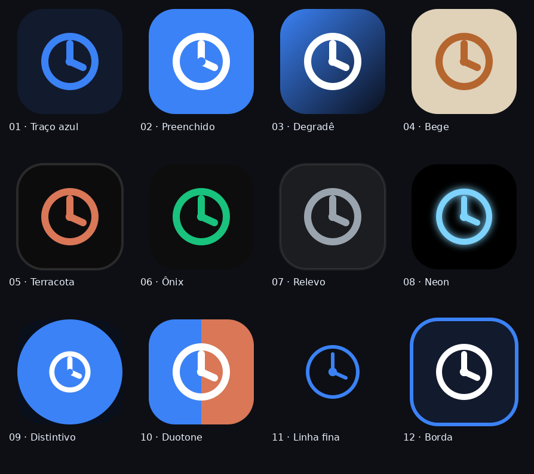
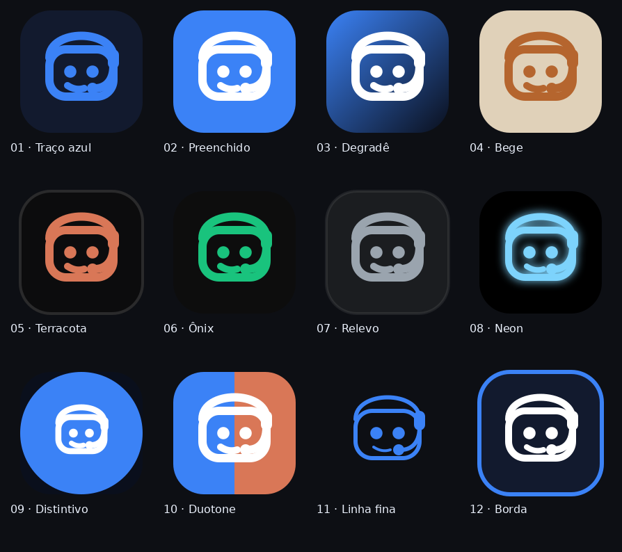
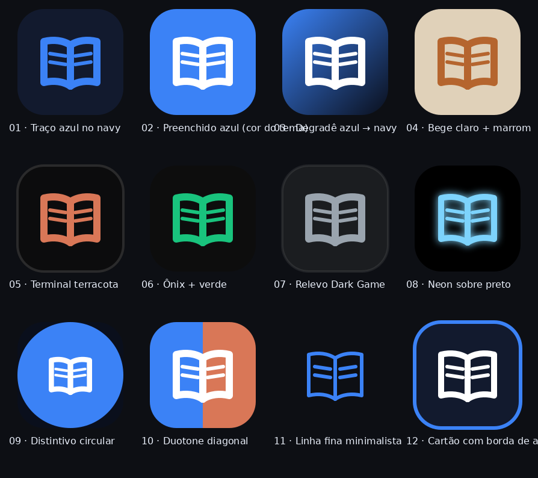
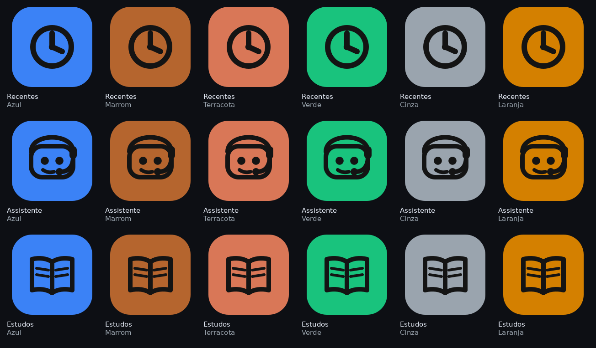

# Ideias de ícones — Recentes · Assistente · Estudos

> Galeria de propostas (12 de cada). **Nada foi alterado no app** — é só visual
> para você escolher. Cada número tem o desenho em 12 tratamentos, nos tons dos
> temas do Taskix (azul, bege, terracota, ônix, Dark Game).
>
> Desenhos: **Recentes** = relógio · **Assistente (Muse)** = cabeça de robô com
> tiara de telemarketing (sua ideia!) · **Estudos** = livro aberto.
> Arquivos `.svg` ao lado de cada grade são a arte final (dá para o app usar
> direto depois).

## Recentes

| 01 · Traço azul no navy | 02 · Preenchido azul | 03 · Degradê | 04 · Bege + marrom |
|---|---|---|---|
|  |  |  |  |
| 05 · Terracota | 06 · Ônix + verde | 07 · Relevo Dark Game | 08 · Neon |
|  |  |  |  |
| 09 · Distintivo circular | 10 · Duotone | 11 · Linha fina | 12 · Borda de acento |
|  |  |  |  |

## Assistente (Muse)

| 01 · Traço azul no navy | 02 · Preenchido azul | 03 · Degradê | 04 · Bege + marrom |
|---|---|---|---|
|  |  |  |  |
| 05 · Terracota | 06 · Ônix + verde | 07 · Relevo Dark Game | 08 · Neon |
|  |  |  |  |
| 09 · Distintivo circular | 10 · Duotone | 11 · Linha fina | 12 · Borda de acento |
|  |  |  |  |

## Estudos

| 01 · Traço azul no navy | 02 · Preenchido azul | 03 · Degradê | 04 · Bege + marrom |
|---|---|---|---|
|  |  |  |  |
| 05 · Terracota | 06 · Ônix + verde | 07 · Relevo Dark Game | 08 · Neon |
|  |  |  |  |
| 09 · Distintivo circular | 10 · Duotone | 11 · Linha fina | 12 · Borda de acento |
|  |  |  |  |

## Como escolher

Me diga os favoritos pelo nome do arquivo (ex.: `assistente-03-degrade`,
`recentes-02-solido-azul`, `estudos-04-bege`) — posso misturar estilos entre os
três botões ou seguir um padrão único. Depois eu implemento no app.

## Preenchidos na cor do tema + desenho preto (13–18)

Cada botão preenchido com a cor do seu tema e o desenho em preto:

| | Azul | Marrom (bege) | Terracota | Verde (ônix) | Cinza (Dark Game) | Laranja (escuro) |
|---|---|---|---|---|---|---|
| Recentes |  |  |  |  |  |  |
| Assistente |  |  |  |  |  |  |
| Estudos |  |  |  |  |  |  |
